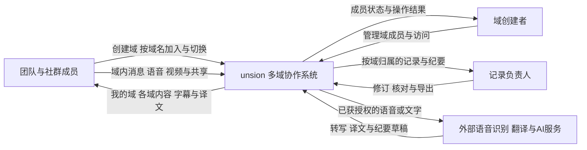
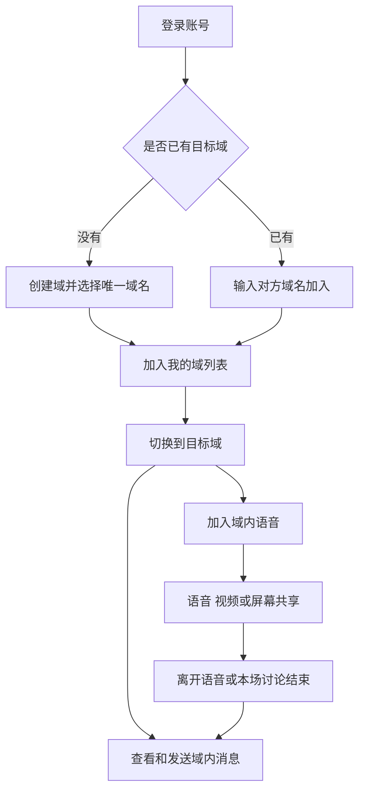

# unsion 多域协作系统需求分析

**提交阶段：** 第一次提交  
**编制日期：** 2026年11月5日  
**小组成员：** 陈雨欣、吴林峰、李思思、谭晶晶  
**指导教师：** 龚伟

本项目面向同时参与多个团队或社群的用户，解决不同圈子的交流入口反复建立、讨论内容难以接续，以及成员在多个协作空间之间切换不便的问题。工作项目、兴趣社群、志愿活动和学习小组都可以建立长期保留的协作空间，称为“域”，用户可以创建自己的域，也可以通过他人的域名加入，之后在已加入的域之间切换，继续聊天、语音讨论或共享材料。

域内保留实时字幕、实时翻译和AI会议记录，使成员能够在不便播放声音时跟上讨论、理解不同语言的发言，并在讨论结束后找到结论与分工。

## 1 业务问题与项目目标

### 1.1 问题陈述

一个人可能白天与工作团队讨论项目，晚上到摄影社群商量拍摄路线，周末再与志愿者协调活动排班，这几个圈子的成员、内容和交流节奏各不相同。如果每次讨论都重新建立交流入口、逐个发送临时邀请，用户不仅要反复寻找进入方式，还容易把工作资料、兴趣话题和活动安排混在一起。

小组还需要在没有全员同时在线时继续工作，例如有人下午留下一个接口问题，另一人晚上才有空回复，第二天其他成员仍需知道问题是否解决，因此交流空间应当随小组持续存在，而不是随着一次语音结束就消失。进入空间之后，成员又会遇到讲解难以跟上、跨语言理解滞后和任务分工记不全等问题，需要分别提供对应的支持。

下表按具体问题列出需求及对应功能，每项功能都有独立的使用理由，后续也按相同编号检查其是否满足需求。

| 编号 | 具体问题与需求 | 对应功能 |
| --- | --- | --- |
| N-01 | 志愿者团队每周都要协调排班，每次重新建立入口会打断协作，需要一个随团队长期存在的固定空间 | 创建并长期保留域 |
| N-02 | 开源项目临时请外部开发者协助调试，双方已经知道目标团队，却还要等待逐个邀请，需要凭一个明确名称直接找到并加入 | 通过唯一域名加入域 |
| N-03 | 用户关闭客户端后，第二天还要继续昨天的讨论，不应再次询问入口或重复加入小组 | 保留成员关系和“我的域”列表 |
| N-04 | 用户结束工作项目讨论后，要去摄影社群确认路线，再回志愿团队查看排班，需要在几个已有空间之间直接切换 | 已加入域之间的切换 |
| N-05 | 成员上线时间不同，无法为一句接口问题把所有人叫进语音，需要把问题和回复留在所属小组供后来者查看 | 域内文字聊天及历史消息 |
| N-06 | 两名成员来回打字仍说不清程序报错的原因，需要即时追问和解释 | 域内实时语音 |
| N-07 | 展示纸面草图或实验装置时，文字和屏幕画面无法呈现正在讲解的实物，需要直接展示摄像头画面 | 域内视频交流 |
| N-08 | 成员解释某段代码或某页报告时，其他人不知道具体指向哪一处，需要同步看到同一个窗口 | 屏幕或窗口共享 |
| N-09 | 用户晚间在合租房间参加讨论，不方便外放声音，又需要理解当前讲解 | 实时语音字幕 |
| N-10 | 网络短暂卡顿，成员漏听了“周四提交”还是“周五提交”，需要回看刚才已经说过的话 | 近期字幕回看 |
| N-11 | 中英混合讨论中，成员理解上一句时已经错过下一句，需要及时获得熟悉语言的译文并能核对原意 | 实时翻译及原文对照 |
| N-12 | 成员一边讲解一边记笔记容易漏掉追问和补充，需要在取得同意后按发言顺序自动保留讨论内容 | 实时文字记录 |
| N-13 | 活动筹备组在讨论中多次调整场地和分工，负责人会后难以从长篇记录中整理最终决定 | AI纪要与行动项提取 |
| N-14 | 接口名、姓名或截止时间被识别错误后，错误可能继续进入译文和纪要，需要修正原文并更新关联内容 | 转写纠正与关联内容更新 |
| N-15 | 用户同时属于多个团队，回顾时需要找到“摄影社群上周的路线讨论”，而不是在所有记录中逐条翻找 | 按域和讨论时间查看记录 |
| N-16 | 项目组要向合作方说明讨论结果，成员需要取得已经核对的纪要作为沟通材料 | 纪要导出 |
| N-17 | 域名被转发后可能有人进入并持续干扰讨论，创建者需要停止其访问，且不能让其再次凭同一域名绕过处理 | 域成员移出与访问限制 |
| N-18 | 成员需要临时与室友说话，或在切换小组时停止展示私人窗口，需要随时控制自己正在发布的内容 | 本人的麦克风、摄像头与共享开关 |
| N-19 | 成员愿意参与当前讨论，却未必同意把内容保存到会后，需要知道记录是否开启并选择是否同意 | 记录授权及可见状态提示 |
| N-20 | 同一个项目域上午排查故障、下午安排版本发布，两次内容需要分开整理，但不应要求成员再次建会 | 自动划分域内语音场次 |
| N-21 | 讨论时某个成员的背景噪声持续盖住讲解，而本人没有及时处理，需要有人先恢复讨论秩序 | 当前语音主持人限制发言 |
| N-22 | 成员误共享了无关窗口且未及时察觉，需要当前主持人能够停止继续展示 | 当前语音主持人终止共享 |
| N-23 | 多名成员同时提出问题，讲解者无法分辨谁要先说，需要明确的发言请求提示 | 举手提示 |

这些场景用于确定需求和后续试用任务，具体实现和测试仍需围绕成员能否完成相应任务展开。

### 1.2 项目目标

| 目标 | 对应需求 | 检查方式 |
| --- | --- | --- |
| 让同一小组的协作能够持续接续 | N-01、N-03、N-05 | 创建活动团队的域，留下排班问题后关闭客户端，重新登录仍能找到该域、查看历史消息并继续回复 |
| 减少加入小组和切换圈子的重复操作 | N-02、N-04 | 用户通过域名加入项目团队和兴趣社群的域，在两者之间切换时无需重新输入域名或等待邀请，且不会误把内容发到另一个域 |
| 使成员围绕同一份材料完成讨论 | N-06至N-08、N-18 | 通过语音解释报错，用共享窗口定位代码，并在展示实物时开启视频，停止发布后其他成员不再收到相应内容 |
| 让成员跟上发言并能核对遗漏内容 | N-09至N-11、N-14 | 在不便外放、短时卡顿和中英交替发言的场景中，检查成员能否借助字幕、回看和译文理解问题，并更正关键错误 |
| 让每次讨论的结论能够找到和复用 | N-12、N-13、N-15、N-16、N-20 | 在同一个域内进行两次讨论，检查记录是否正确归属、最终决定与分工是否准确，以及确认后的纪要能否导出 |
| 让固定空间的访问、秩序与记录保持可控 | N-17、N-19、N-21至N-23 | 检查被移出成员是否仍能访问、主持人能否处理噪声和误共享、举手状态是否可见，以及未完成确认时是否保存新增记录 |

### 1.3 项目价值

域承担的是团队或社群长期交流的入口，域内语音承担的是某一次即时讨论，两者分开后，用户可以在多个圈子之间切换，不必为了继续昨天的话题重新建立空间。聊天历史和讨论记录按域保留，也让临时缺席的成员有机会补上进度，而字幕、翻译和AI整理分别处理会中理解与会后回顾的问题。

## 2 问题范围与产品边界

### 2.1 首期建设范围

| 范围 | 具体内容与需求依据 |
| --- | --- |
| 服务对象 | 工作项目团队、兴趣社群、志愿活动团队、学习与研究小组，以及同时参与多个圈子或有跨语言交流需求的成员 |
| 客户端 | 桌面浏览器，首期在Windows 11上的Chrome和Edge开展验证，记录具体版本 |
| 空间组织 | 支持创建域、按域名加入、保留已加入域和切换当前域，对应N-01至N-04 |
| 域内交流 | 提供文字聊天、语音、视频和单人屏幕共享，对应N-05至N-08，并允许成员控制本人的发布状态，对应N-18 |
| 理解发言 | 提供实时字幕、近期字幕回看、中英互译及原文对照，对应N-09至N-11 |
| 讨论整理 | 提供授权后的实时文字记录、AI纪要、内容修订、按域查看和纪要导出，对应N-12至N-16 |
| 域与语音管理 | 创建者移出干扰成员，语音活动自动划分场次，记录另行取得同意，当前主持人可限制发言和终止共享，成员可举手，对应N-17、N-19至N-23 |
| 容量目标 | 单域一次语音活动最多10人，同时支持4路摄像头和1路共享；域的长期成员容量、多个域并行语音及识别服务处理能力分别测试 |
| 本期不纳入 | 原始音视频录像保存、完整项目进度管理、大型直播、计费、原生移动端及硬件会议室接入 |

域在没有成员在线时仍然保留，语音人数上限不等于域的长期成员上限；字幕、翻译和记录也要在多人讨论条件下分别验证，不能仅以能够进入语音的人数判断处理能力。

后续可探索基于摄像头的手语翻译功能，是否纳入需评估模型能力、摄像头等设备条件、识别效果、实时性及部署成本，目前不列入首期交付范围。

### 2.2 系统上下文

系统内部负责域、成员关系、消息历史、语音场次、共享、字幕显示和记录管理，语音识别、翻译与纪要生成可以调用外部服务，但输入授权、结果修订、失败提示和访问权限仍由本系统管理。数据库、媒体处理等内部组件不作为外部参与者，域名也只表示平台内唯一的空间名称或标识，不要求用户注册互联网域名。

登录用户取得有效域名后即可加入对应的域并使用域内交流入口，首期不设置邀请码、入域口令或人工审批，也不要求每次语音重新发送邀请；域名用于定位空间，实际内容访问仍与账号的域成员身份关联，被移出并受限制的账号不能再次凭同一域名加入。

语音和文字送往外部服务前需要向相关成员说明用途并取得授权，若还需保存为会后记录，则由当前语音参与者另行确认；这些确认只影响相应处理和保存，不作为加入域的审批条件。

## 3 利益相关者与价值冲突

### 3.1 利益相关者清单

| 编号 | 利益相关者 | 具体关切 | 参与方式 |
| --- | --- | --- | --- |
| ST-01 | 同时参加多个团队或社群的用户 | 能找回各圈子的固定入口，切换时不误发消息或误共享 | 走查建域、入域、重新登录和多域切换任务 |
| ST-02 | 域创建者 | 小组有固定空间，其他成员凭域名即可进入，发生干扰时能够处理 | 确认命名、加入和成员管理规则 |
| ST-03 | 域内语音参与者 | 能听清讨论、看准共享内容，随时停止自己的声音和画面 | 试用语音、视频、共享和设备开关 |
| ST-04 | 跨语言讨论成员 | 能及时获得译文，并核对术语、否定词和关键数字 | 提供中英讨论样例，检查字幕与翻译 |
| ST-05 | 记录负责人 | 每次讨论独立归档，能修正纪要中的错误分工 | 核对转写、修订、场次归属和导出结果 |
| ST-06 | 项目负责人、社群组织者及活动协调者 | 本组内容不与其他组混杂，缺席成员能找到此前结论 | 确认消息历史和记录的归属、查看范围 |
| ST-07 | 开发、测试与运行支持成员 | 能区分域切换、媒体故障和识别服务故障，明确资源消耗 | 记录试验条件与故障结果，评估并行处理能力 |
| ST-08 | 指导教师 | 每项功能能说明解决哪个现实问题，首期工作量与验证路径明确 | 阶段评审与任务检查 |
| ST-09 | 外部能力服务提供方 | 调用内容、授权和处理范围符合接口约定 | 提供语音、翻译和AI处理接口及约束 |

同一名用户可以是工作项目域的普通成员，也是摄影社群域的创建者，其权限应按所在域分别判断，不能把一个域的管理身份带到另一个域。

### 3.2 价值冲突与处理原则

| 具体冲突 | 处理原则 |
| --- | --- |
| 凭域名快速加入与处理干扰 | 正常加入不需要等待审批，创建者移出并限制的账号则不能重复入域，管理结果仅作用于该域 |
| 快速切换与声音、画面误传 | 切换域时退出原域语音并停止共享，保留原域成员身份，进入新域后由本人决定是否加入语音和开启设备 |
| 长期聊天与临时讨论的边界 | 域内消息按域持续保留，实时字幕默认仅供当前场次查看，转为会后记录需要另行取得同意 |
| 实时显示与识别准确性 | 允许查看正在识别的字幕，也允许纠正名称和数字；无法辨认时标明缺失，不补造发言 |
| AI整理与结论可信度 | AI生成草稿，没有明确说出的负责人、时间和决定保留为待确认，由记录负责人核对后发布 |
| 记录完整性与成员选择 | 是否保存记录独立于是否入域或加入语音，未取得当前参与者同意时暂停新增保存，不阻止继续讨论 |
| 故障定位与内容保护 | 技术日志和域内内容分开保存，日志只记录操作标识、耗时和错误码，不写入发言正文、口令或令牌 |

## 4 客户细分与典型用户画像

### 4.1 客户细分

客户按照共同活动、交流内容和协作周期划分，跨语言需求可以出现在任一群体中，域创建者、语音主持人和记录负责人则属于具体空间或活动中的角色。

| 编号 | 群体 | 具体协作需求 | 对应需求 |
| --- | --- | --- | --- |
| SEG-01 | 工作项目与开源协作团队 | 持续调试、讲解方案和安排任务，需要保留入口、共享材料并找回讨论结论 | N-02、N-05、N-06、N-08、N-13、N-16 |
| SEG-02 | 兴趣社群 | 围绕摄影、游戏或创作反复交流，需要随时加入、继续旧话题并约定共同活动 | N-01、N-03、N-05、N-15 |
| SEG-03 | 志愿者与活动筹备团队 | 多次调整排班、场地和分工，新成员需要快速进入并了解当前安排 | N-01、N-02、N-12、N-13、N-15 |
| SEG-04 | 学习与研究小组 | 定期讲解材料、展示过程和讨论问题，需要共享画面、回看发言并整理结论 | N-07、N-08、N-09、N-10、N-11 |
| SEG-05 | 同时参与多个团队或社群的用户 | 工作、兴趣和活动安排并行，需要快速切换空间并避免内容混杂 | N-03、N-04、N-18 |

首期从上述群体中选择小规模团队和社群开展验证，不以学校或单位身份限制使用，也不把大型培训、公开直播等场景的规模与组织要求纳入当前目标。

### 4.2 典型用户画像

#### P-01 在工作、兴趣和志愿活动之间切换的用户

这名用户白天与项目组修改方案，晚上到摄影社群确认周末路线，期间还要查看志愿团队的排班回复，希望打开系统就能找到已经加入的几个域，并在切换后接着各自的话题讨论；正在处理工作内容时，也需要明确知道声音和共享画面属于哪个域，避免把项目资料展示给兴趣社群。

#### P-02 为团队维持交流入口的组织者

活动组织者每周需要与同一批志愿者确认排班，也会临时请场地协调人员加入讨论，因此需要一个创建后便能长期使用的域，并通过域名告诉对方去哪里加入；组织者同时负责讲解和记录安排，希望系统保留聊天、区分每次语音讨论，再由自己核对AI整理的决定与行动项。

#### P-03 参与中英混合讨论的成员

这类成员在开源项目中与其他语言的开发者讨论接口文档时能听懂大意，却可能漏掉专业术语、否定词和具体时间，希望在项目域内直接使用双语字幕，并在出现疑问时回看近期发言；经纠正的原文应同步更新译文和待核对纪要，避免团队继续依据错误内容讨论。

#### P-04 不方便播放声音的普通成员

用户晚间在合租房间进入项目域时可能没有耳机，也不便打扰已经休息的同住者，仅看共享窗口又无法理解报错讲解，因此需要通过字幕了解当前发言、向前回看遗漏内容，并用文字提出问题，而不必因为不能收听就退出讨论。

## 5 领域理解与业务规则对象

### 5.1 主要领域概念

| 概念 | 定义与关系 |
| --- | --- |
| 域 | 围绕共同项目、兴趣或活动建立的长期协作空间，包含成员关系、聊天历史及域内讨论记录，不随一次语音结束而消失 |
| 域名 | 平台内唯一、可由创建者选择的空间名称或标识，重名时提示重新选择，其他登录用户可以据此定位并加入域 |
| 域创建者 | 建立并管理域的账号，可以移出和限制干扰成员，其权限只作用于该域 |
| 域成员关系 | 账号加入某个域后形成的关系，一个账号可以属于多个域，关闭客户端或结束语音不解除该关系 |
| 当前域 | 用户此刻正在查看或操作的空间，其聊天、语音入口和记录都应具有明确的域归属 |
| 域内消息 | 发送到指定域的文字内容，保存于该域的聊天历史，供成员接续交流 |
| 语音场次 | 域内一次连续的即时语音活动，由首位成员加入时自动形成，所有成员离开或当前主持人结束活动后终止，不需要用户另行建会 |
| 语音主持人 | 当前场次的管理角色，首位进入语音者担任并可转交，负责限制发言、终止共享和结束本场讨论，不因担任该角色而取得其他域的权限 |
| 发言片段 | 带有来源成员、域和场次信息的一段发言，是字幕、翻译和记录的组织依据 |
| 字幕与译文 | 当前场次的原文和目标语言文字，可回看近期内容，并与发言片段及修订版本关联 |
| 记录授权 | 当前语音参与者对保存本次讨论内容的确认，独立于域成员资格和媒体设备授权 |
| 讨论记录 | 经授权保存的某次语音文字，归属于所在域和具体场次，不包含原始音视频录像 |
| 纪要与行动项 | 根据该次记录整理的决定、待确认问题及任务分工，没有明确的信息保持待确认 |
| 记录负责人 | 有权核对、修订和发布本次纪要的成员，权限在本域及相应记录范围内生效 |

域和域内语音采用不同的持续时间：域负责长期组织成员及内容，语音场次负责区分某一次讨论，而同一场次的字幕、译文和纪要通过发言来源及版本关联，方便修订后同步更新或返回原文核对。

### 5.2 加入、切换与离开的关系

创建者选择未被占用的域名后即可使用自己的域，其他登录用户输入有效域名即可加入，成员关系保留在“我的域”列表中，之后切换无需重复加入。进入域可以先看消息，也可以直接从语音入口参与当前讨论，无需建立临时会议或等待新的邀请。

切换域只改变当前协作空间，不删除原域的成员关系或消息；如果用户正在原域发言或共享，切换时退出该语音并停止发布，进入新域后再由本人开启相应交流。离开语音只结束本人的当前参与，普通成员主动退出域才会从“我的域”列表移除并结束成员关系；再次加入仍可通过域名完成，但已被创建者限制的账号除外。

域内语音的首位参与者成为当前主持人，可以转交主持权或结束本场语音；普通成员离开不会结束其他人的讨论，所有人离开后场次自动结束，域及其历史内容仍然保留，下一次语音活动自动形成新的场次。主持人意外离线时由仍在线的成员接管，其他成员不需要重新加入域。

### 5.3 域内记录的形成与保存

域内文字消息作为持续聊天的一部分保留，语音转写是否保存成会后记录则需当前参与者另行同意；开启字幕不自动启动保存，新增成员进入正在记录的语音时先暂停新增保存，完成当前全体参与者确认后再继续，不影响其入域或参与讨论。

每次语音场次都具有独立的记录归属，记录负责人可以在讨论中纠正名称和时间，结束后再核对AI提取的决定与行动项，确认后发布到本域；尚未明确的内容保持待确认，已发布纪要的再次修改也需要人工核对。

记录按域和讨论时间组织，成员只能在所属域内按权限查看相应内容，导出和删除还需具备对应权限；删除时一并清理系统内关联的转写、译文、纪要及导出副本，但无法撤回成员已经下载到系统外的文件。退出域或被移出后不再获得该域后续内容的访问权限，切换到其他域也不会使原域记录对新域成员可见。
